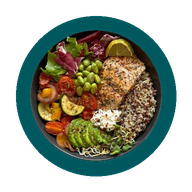
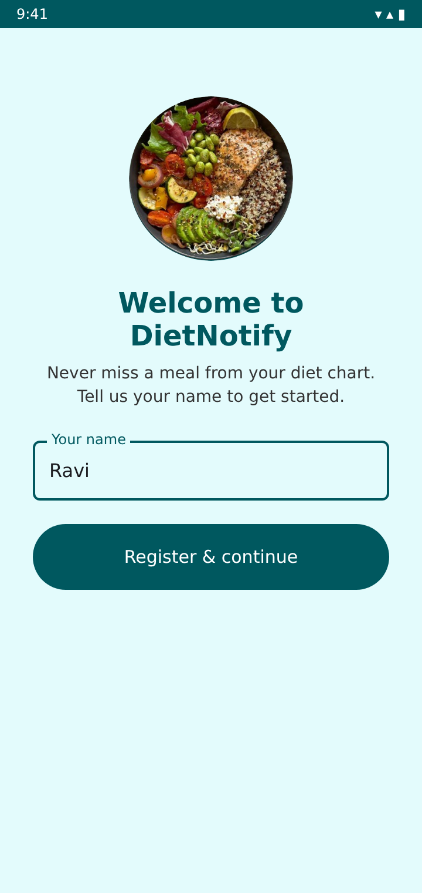
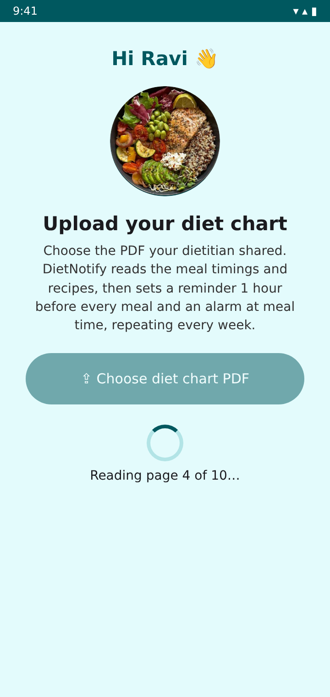
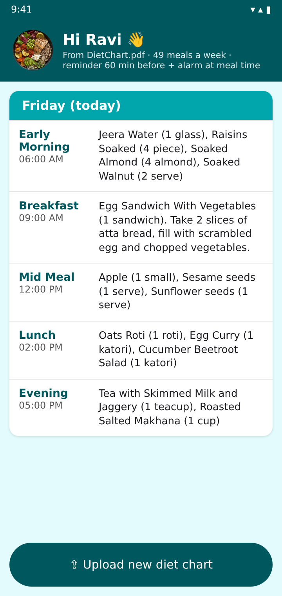
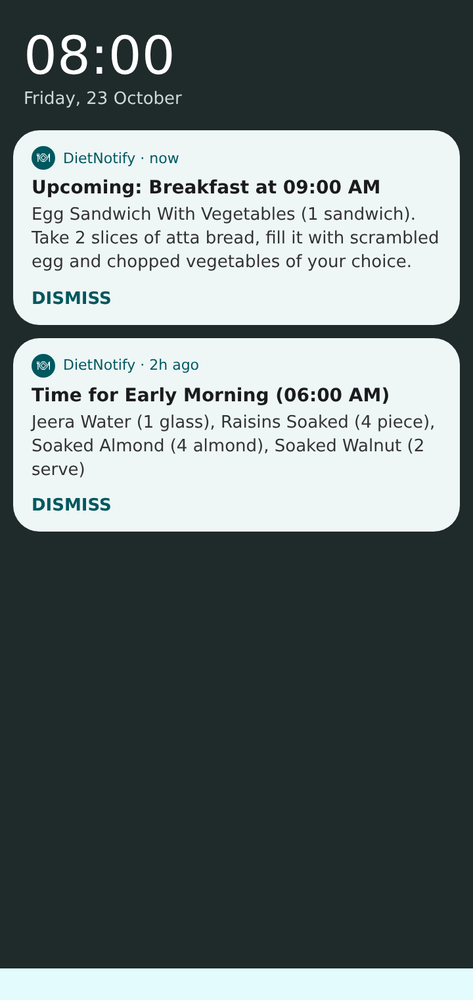
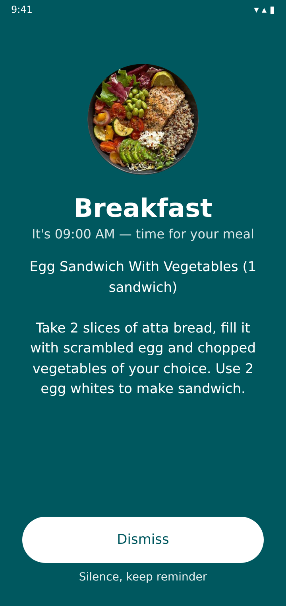
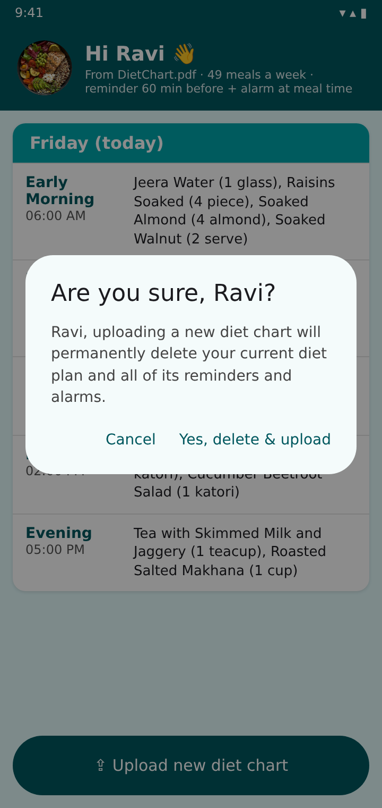
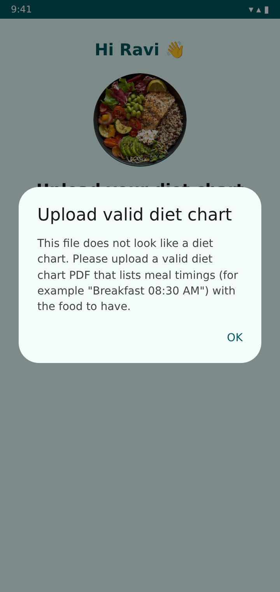

<p align="center"></p>

# DietNotify

Android app that turns a diet chart PDF into weekly meal reminders and alarms.

<p align="center">
  
  
  
</p>

## Download

Every push builds the app on GitHub Actions and publishes **DietNotify.apk** on the
[Releases page](https://github.com/naddanki87/dietnotification/releases). Open it on an
Android 8.0+ phone and allow installing from unknown sources.

## How it works

1. **Register**: on first launch, enter your name.
2. **Upload diet chart**: pick the PDF from your dietitian. Pages are read with on-device OCR
   (ML Kit), so scanned or image-only PDFs work too, without internet.
   - The app finds each day (weekday, date like `18-10-2026` or `DAY 1`), each meal
     (`Breakfast`, `Lunch`…), its time (`09:00 AM`) and the food / recipe next to it.
   - If the PDF has no meal timings, it is rejected with **"Upload valid diet chart"**.
3. **Alerts are set automatically** for every meal, repeating every week:
   - a **reminder notification 1 hour before** the meal, with the recipe;
   - an **alarm at the meal time** that rings, shows full screen and displays the recipe.
   - Both notifications stay until you tap **Dismiss**. Alerts survive reboots and time zone changes.
4. **Upload a new chart**: the app asks *"Are you sure, &lt;name&gt;?"*, then deletes
   the old plan with all its reminders and alarms before you upload the new PDF.

## Screens

| Register | Upload PDF | Weekly plan |
|:---:|:---:|:---:|
|  |  |  |
| **Reminder notifications** | **Meal-time alarm** | **Re-upload confirmation** |
|  |  |  |
| **Invalid PDF** | | |
|  | | |

*Screen previews rendered from the app's layouts, colours and strings, filled with the meals
parsed from a sample diet chart.*

## Build locally

```
./gradlew assembleRelease   # app/build/outputs/apk/release/app-release.apk
./gradlew testDebugUnitTest # parser and scheduling tests
```

The APK is signed with `app/dietnotify.keystore`, a key committed so every build can
update an installed copy. Replace it with a private key before publishing on the Play Store.
